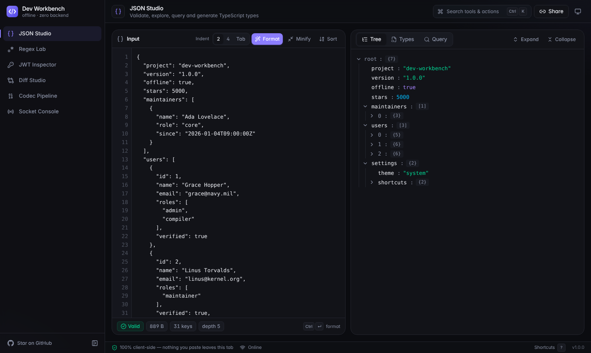
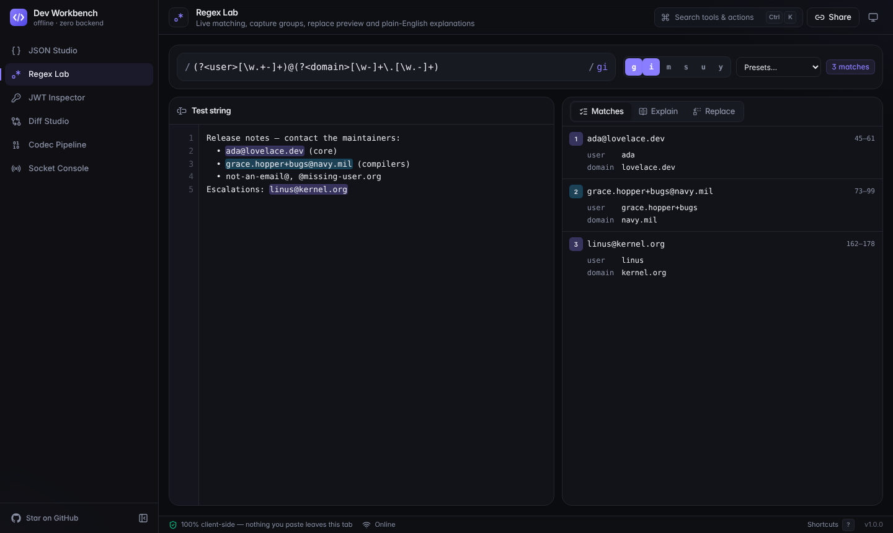
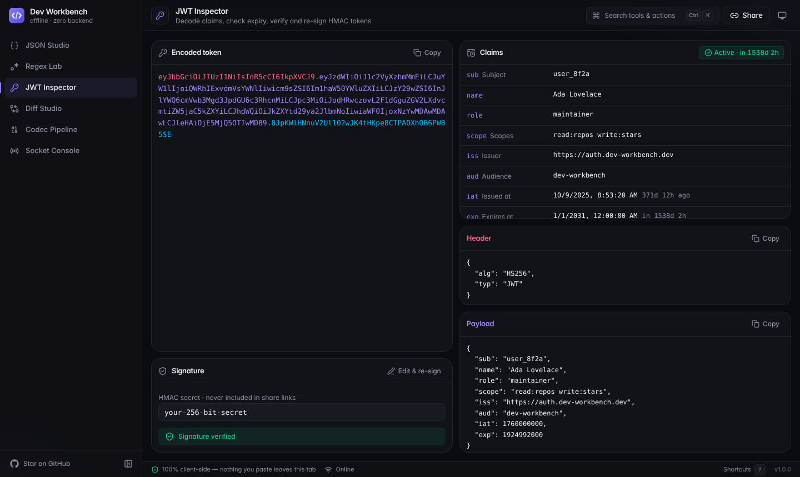
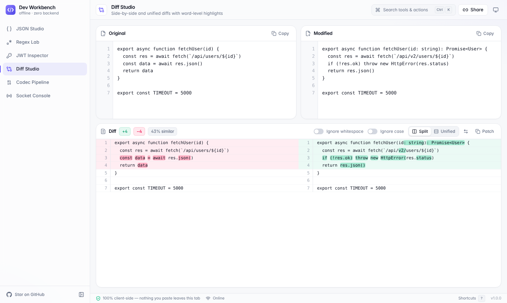
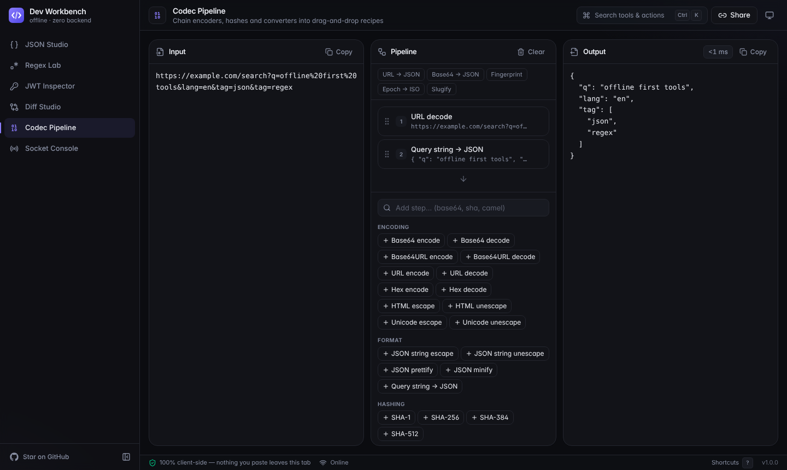
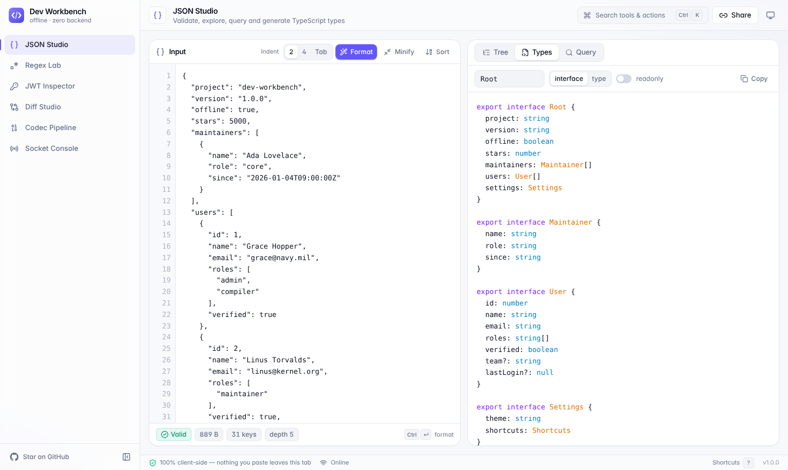
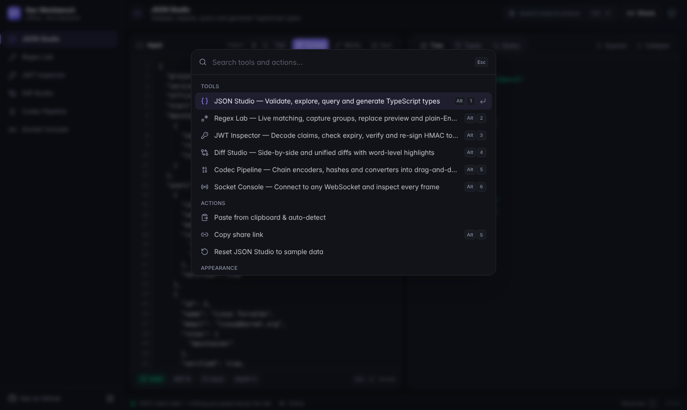
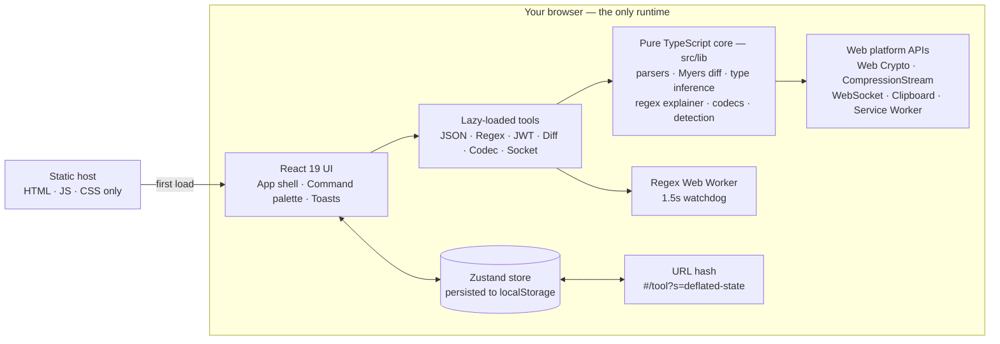

<div align="center">


# Dev Workbench

### Paste anything. It figures out the rest.

**The offline-first developer toolbox — JSON, Regex, JWT, Diff, encoder pipelines and WebSocket debugging in one beautiful tab. Zero backend. Zero tracking. Zero install.**

[](https://github.com/zzoraemon043/dev-workbench/actions/workflows/ci.yml)
[](LICENSE)
[](https://github.com/zzoraemon043/dev-workbench/stargazers)
[](CONTRIBUTING.md)
[](tsconfig.app.json)
[](#privacy-by-architecture)

[**Live demo**](https://zzoraemon043.github.io/dev-workbench/) · [Features](#-features) · [Quick start](#-quick-start) · [Architecture](#-architecture) · [Contributing](CONTRIBUTING.md)



</div>

---

## Why?

Every developer has a bookmark folder full of single-purpose websites: one to pretty-print JSON, one to decode a JWT, one to test a regex, one to diff two snippets. Most of them are slow, covered in ads, and quietly ship whatever you paste — **production tokens included** — to someone else's server.

**Dev Workbench** replaces that folder with one fast, keyboard-driven tab that never talks to a backend. It is a static site: open it once and it keeps working on a plane.

## Features

| Tool | What makes it different |
|---|---|
| **JSON Studio** | Validation with exact line/column errors and jump-to-error · collapsible tree with **click-to-copy JSONPath** · **JSON → TypeScript interfaces** (optional keys, unions, deduplicated shapes) · JSONPath query with `..` recursive descent, `[*]` and negative indices |
| **Regex Lab** | Live in-editor match highlighting · named & numbered capture groups with offsets · replace preview with `$<name>` · **plain-English explanation** of every token · runs in a **Web Worker with a 1.5 s kill switch**, so `(a+)+$` can never freeze your tab |
| **JWT Inspector** | Color-coded token anatomy · human-readable claims with live expiry countdown · **offline HS256/384/512 verification** via Web Crypto · **edit the payload and re-sign** to craft test tokens |
| **Diff Studio** | Myers O(ND) line diff with **word-level highlights** · split & unified views · ignore whitespace/case · copy as unified patch |
| **Codec Pipeline** | **Chain transforms like CyberChef-lite**: Base64/URL/Hex/HTML/Unicode, SHA-1/256/384/512, case conversion, timestamps, query-string → JSON · **drag to reorder** · per-step previews & timing |
| **Socket Console** | Connect to any `ws://`/`wss://` endpoint · JSON-aware frame log with filters, byte counters and expandable payloads · export the session as JSON |

### Workbench-wide capabilities

- **Smart paste** — press <kbd>Ctrl/⌘</kbd>+<kbd>V</kbd> anywhere outside an editor. A JWT opens the JWT Inspector, JSON opens JSON Studio, `wss://…` opens the Socket Console, base64 or a Unix timestamp lands in the Codec Pipeline with the right decoder already attached.
- **Share links without a server** — <kbd>Alt</kbd>+<kbd>S</kbd> compresses the current tool's state (`deflate-raw` + base64url) into the URL hash. Hashes are never sent to servers, and **secrets such as HMAC keys are never included**.
- **Keyboard-first** — <kbd>Ctrl/⌘</kbd>+<kbd>K</kbd> command palette with fuzzy search, <kbd>Alt</kbd>+<kbd>1–6</kbd> to switch tools, <kbd>Ctrl/⌘</kbd>+<kbd>Enter</kbd> runs each tool's primary action, <kbd>?</kbd> lists everything.
- **Drag and drop**: drop a file onto any editor to load it.
- **Theming**: light, dark and system modes with no flash on load.
- **Local persistence**: workspace state is restored from `localStorage` between visits.
- **Installable PWA**: a service worker caches the app shell so it runs fully offline.

<table>
  <tr>
    <td width="50%"><p align="center"><b>Regex Lab</b> — live highlights and capture groups</p></td>
    <td width="50%"><p align="center"><b>JWT Inspector</b> — claims, expiry and offline verification</p></td>
  </tr>
  <tr>
    <td width="50%"><p align="center"><b>Diff Studio</b> — word-level split diff</p></td>
    <td width="50%"><p align="center"><b>Codec Pipeline</b> — drag-and-drop transform chains</p></td>
  </tr>
  <tr>
    <td width="50%"><p align="center"><b>JSON → TypeScript</b> in light mode</p></td>
    <td width="50%"><p align="center"><b>Command palette</b> — everything is one keystroke away</p></td>
  </tr>
</table>

## Quick start

**Use it now:** open the [live demo](https://zzoraemon043.github.io/dev-workbench/) — nothing to install.

**Run it locally (one line):**

```bash
git clone https://github.com/zzoraemon043/dev-workbench.git && cd dev-workbench && npm install && npm run dev
```

Then open http://localhost:5173. Requires Node.js 22.13+ (see `.nvmrc`).

| Script | Purpose |
|---|---|
| `npm run dev` | Start the Vite dev server with HMR |
| `npm run build` | Type-check and build a static bundle into `dist/` |
| `npm run preview` | Serve the production build locally |
| `npm test` | Run the Vitest unit suite |
| `npm run lint` | Lint with ESLint (typescript-eslint + React hooks rules) |

**Self-host anywhere:** `dist/` is plain static files. Drop it on GitHub Pages, Netlify, Vercel, Cloudflare Pages, S3, or `python -m http.server`. To serve from a sub-path, build with `BASE_PATH=/your-path/ npm run build`.

## Architecture



**Design principles**

1. **The core is framework-free.** Everything in `src/lib` is pure, synchronous-where-possible TypeScript with no React imports, so it is trivially unit-tested and reusable.
2. **Tools are plugins.** Each tool is a lazy-loaded component registered in [`src/tools/registry.ts`](src/tools/registry.ts); the shell, command palette, shortcuts and router derive from that list. Adding a tool is one file plus one registry entry.
3. **Never block the main thread.** Untrusted regexes run in a Web Worker with a watchdog; large inputs flow through `useDeferredValue`; the JSON tree paginates large arrays.
4. **No network by construction.** There is no API client in the codebase. The only network calls are the ones you initiate in the Socket Console.

```text
src/
├── app/            command definitions & global shortcuts
├── components/     design system: Panel, Button, CodeEditor, Dialog, palette…
├── hooks/          hotkeys, theme, clipboard, file drop, smart paste, hash sync
├── lib/            pure TypeScript core (+ *.test.ts next to each module)
│   ├── json/       parse · JSONPath query · JSON → TypeScript
│   ├── regex/      engine · explainer · presets
│   ├── jwt/        decode · claims · HMAC sign/verify
│   ├── diff/       Myers algorithm · line/word diff · patch
│   ├── codec/      byte utilities · transform registry · pipeline runner
│   ├── share/      compressed share links
│   └── detect.ts   content detection for smart paste
├── store/          Zustand stores (workbench, socket, toasts)
└── tools/          one folder per tool, lazy-loaded
```

## Privacy by architecture

- No analytics, cookies, or third-party scripts. Fonts are system fonts.
- All parsing, hashing and signing happens in your browser via standard Web APIs.
- Share links live in the URL **fragment**, which browsers never send to servers.
- HMAC secrets are excluded from share links and stay in your local storage only. Clear them any time via the command palette (**Reset tool**).

## Roadmap

- [ ] RS256/ES256 verification with a pasted JWK/PEM
- [ ] JSON Schema validation & schema generation
- [ ] cURL ⇄ `fetch` converter
- [ ] Cron expression explainer
- [ ] Mock REST server powered by a Service Worker
- [ ] Workspace export/import

Have an idea? [Open a feature request](https://github.com/zzoraemon043/dev-workbench/issues/new?template=feature_request.yml) — tools are designed to be easy to contribute.

## Contributing

Contributions of every size are welcome — from typo fixes to whole new tools. Read the [contributing guide](CONTRIBUTING.md) to get started and look for issues labelled [`good first issue`](https://github.com/zzoraemon043/dev-workbench/labels/good%20first%20issue).

By participating you agree to follow the [Code of Conduct](CODE_OF_CONDUCT.md).

## Support

If Dev Workbench saved you a trip to a sketchy ad-covered website, **give it a star** — it genuinely helps other developers find it.

[](https://star-history.com/#zzoraemon043/dev-workbench&Date)

## License

[MIT](LICENSE). Copyright (c) 2026 Dev Workbench contributors.

